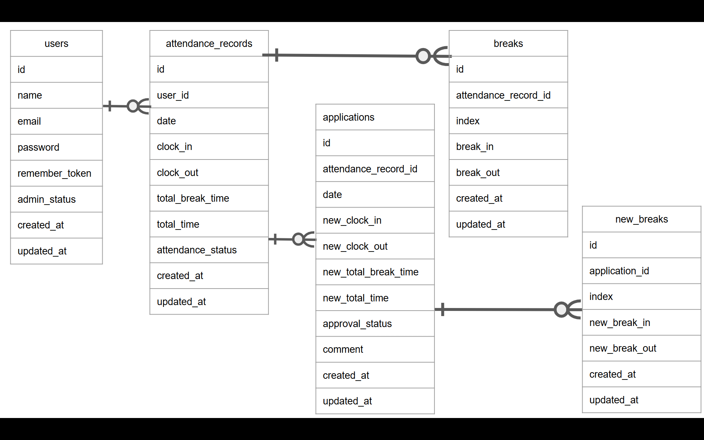

# アプリケーション名
- 「勤怠管理アプリ」

## 環境構築手順
- このプロジェクトをローカル環境で動かすための手順

### 前提条件
- DockerおよびDocker Desktopがインストールされていること

### 手順
- Bash機能が使えないです　使い方を教えてほしいです　とりあえず地の文のまま見てください
- 1.リポジトリをクローンする
- git clone https://github.com/Mizuho-Watanabe/simulation-attendance-app.git
- cd attendance-app

- 2.環境変数ファイルを作成する
- cp .env.example .env
- .envファイル内の以下のDB接続情報を確認・設定する
- DB_CONNECTION=mysql
- DB_HOST=mysql
- DB_PORT=3306
- DB_DATABASE=laravel
- DB_USERNAME=sail
- DB_PASSWORD=password

- 3.composerパッケージをインストールする
- docker run --rm \
    -u "$(id -u):$(id -g)" \
    -v "$(pwd):/var/www/html" \
    -w /var/www/html \
    laravelsail/php82-composer:latest \
    composer install

- 4.Sailを起動し、アプリケーションキーの生成とマイグレーションを行う
- ./vendor/bin/sail up -d
- ./vendor/bin/sail artisan key:generate
- ./vendor/bin/sail migrate

- 5.依存パッケージのインストールと起動
- ./vendor/bin/sail npm install
- ./vendor/bin/sail npm run dev

- 6.アプリケーションの起動
- npm run dev

- 7.動作確認
ブラウザで`http://localhost`にアクセスし、画面が表示されることを確認

## 使用技術
- Laravel 10
- MySQL 8.0
- Nginx
- Docker

## ER図

## APIエンドポイント一覧
- 

## URL
- 開発環境 :　http://localhost
- phpMyAdmin : http://localhost:8080

## 作成者
- 渡辺瑞穂